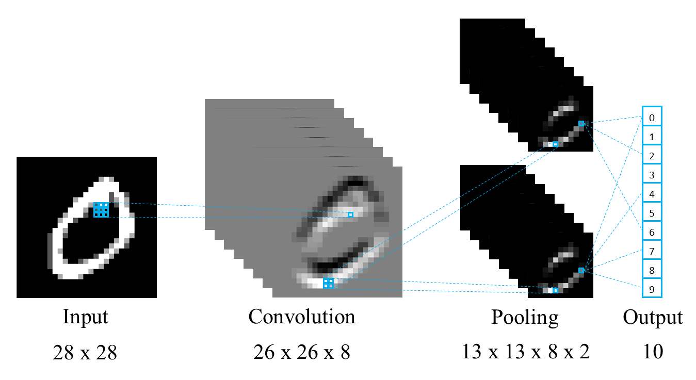

Spiking Neural P Systems for CNN
==================================

This project provides a Python implementation of **Spiking Neural P Systems (SN P systems)**, a distributed and parallel computing model inspired by the way biological neurons communicate through spikes.

The aim of the work is to recreate the main mechanisms of a Convolutional Neural Network (CNN) in order to perform an image classification task using the SN P system.

The framework includes: - Extended SN P systems (multi-spike firing rules) - Inhibitory synapses with anti-spikes - Lightweight architecture without synaptic weights.

The project has been developed in collaboration between the University of Milano-Bicocca and the University of Verona.

This repository is a fork of:

https://github.com/SandroErba/spiking-p-system

which, in turn, is based on the original implementation by:

https://github.com/a1sabau/spiking-p-system

The task is run on the `MNIST <https://www.kaggle.com/datasets/hojjatk/mnist-dataset>`_ database, and there are numerous parameters in the config.py file that allow you to change the behaviour and structure of the network.

The overall architecture of the simulator is illustrated below.

Installation
------------

Clone the repository:

.. code-block:: bash

   git clone https://github.com/SandroErba/From-CNN-to-SNPS.git
   cd From-CNN-to-SNPS

Create a virtual environment (optional but recommended):

.. code-block:: bash

   python -m venv venv
   source venv/bin/activate      # Linux / macOS
   venv\Scripts\activate         # Windows

Install the required dependencies:

.. code-block:: bash

   pip install -r requirements.txt

Usage
-----

Run the simulator with:

.. code-block:: bash

   python main.py

Results
------------
In the ‘graphs/accuracy_graphs’ folder, you can find the results for the model and its sub-models as certain parameters are varied.

